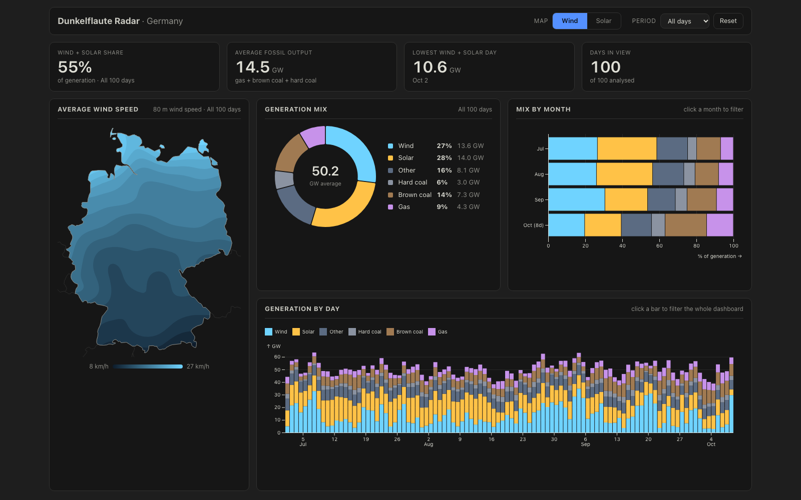
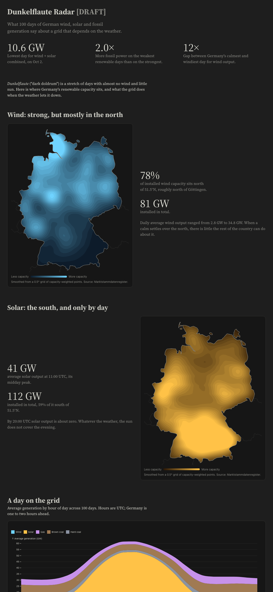
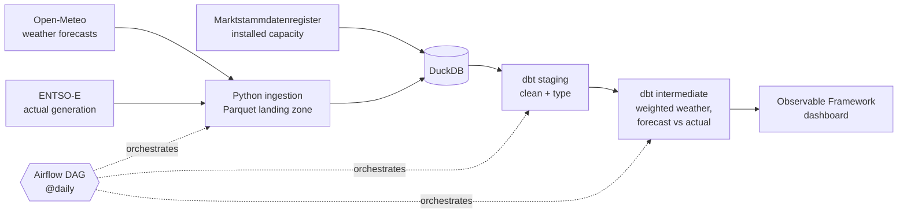

<div align="center">

# 🌬️ Dunkelflaute Radar

**What happens to Germany's power grid when the wind stops and the sun goes down?**

An end-to-end data engineering project: weather and generation data in, tested dbt models in the middle, an interactive dashboard out.




</div>

---

## Table of contents

- [The problem](#the-problem)
- [The dashboard](#the-dashboard)
- [Architecture](#architecture)
- [Tech stack](#tech-stack)
- [Data sources](#data-sources)
- [Data model](#data-model)
- [Getting started](#getting-started)
- [Project structure](#project-structure)
- [Roadmap](#roadmap)

---

## The problem

*Dunkelflaute* ("dark doldrums") is a German word for a stretch of days with almost no wind and little sun. Germany gets more than half its electricity from wind and solar, so these windows are where the grid is under stress: fossil plants have to fill the gap.

This project asks two questions:

1. **What does the grid actually do** when renewables fall short?
2. **How good are weather forecasts** at predicting those windows before they happen?

## The dashboard

A single-screen, filterable dashboard built with [Observable Framework](https://observablehq.com/framework/). Every panel reacts to the same filter, so you can click a month (or a single day) and watch the whole screen re-slice.

| Panel | What it shows |
| --- | --- |
| **KPI row** | Wind + solar share, average fossil output, the weakest renewable day, days in view |
| **Weather map** | Wind speed or solar radiation across Germany, interpolated from 293 grid points |
| **Generation mix** | Share of wind, solar, gas, coal and others for the selected period |
| **Mix by month** | Stacked bars; click a month to filter |
| **Generation by day** | One bar per day; click a day to filter |

Highlights from the first 100 days of data (Jul to Oct 2026):

- Wind + solar produced **55%** of German generation on average.
- On the weakest renewable days, fossil output was about **2× higher** than on the strongest.
- Wind output varied **12×** between Germany's calmest and windiest day.
- **78%** of installed wind capacity sits in the north, while solar is concentrated in the south and drops to about zero by evening.

There is also a longer, narrative version of the analysis (`/story`) that walks through these findings with annotated maps and charts.

<div align="center">

</div>

## Architecture



The daily Airflow DAG runs: `ingest_weather → ingest_entsoe → dbt run → dbt test`. A failed test stops the pipeline before bad data reaches the dashboard.

**Key design decisions**

- **Capacity-weighted weather, not a single point.** Weather is sampled on a 0.5°×0.5° grid (293 points over Germany) and weighted by real installed wind and solar capacity. A calm day in Bavaria matters little for wind; a calm day in Schleswig-Holstein matters a lot.
- **Partitioned Parquet landing zone.** Raw data is written to `data/raw/` partitioned by `zone` and `ingest_date`. It stands in for an S3 data lake, so the later move to AWS only changes the path.
- **Forecasts are kept by ingestion time.** Each forecast run is stored with its `ingest_ts`, so the model can compute lead time and compare "what was predicted" against "what happened".
- **Data loaders for the dashboard.** The Observable pages read from small Python loaders (`dashboard/src/data/*.json.py`) that query DuckDB at build time. No backend to run.

## Tech stack

| Layer | Tool |
| --- | --- |
| Ingestion | Python 3.11, managed with [uv](https://docs.astral.sh/uv/) |
| Storage | Parquet (landing zone), DuckDB (warehouse) |
| Transformation | dbt (staging, intermediate, tests, source freshness) |
| Orchestration | Apache Airflow on Docker Compose |
| Dashboard | Observable Framework, D3, Observable Plot |
| Tests | pytest (ingestion), dbt tests (data) |

## Data sources

| Source | What | Notes |
| --- | --- | --- |
| [Open-Meteo](https://open-meteo.com/) | Weather forecasts (wind at several heights, solar radiation) | Free, no key |
| [ENTSO-E Transparency Platform](https://transparency.entsoe.eu/) | Actual generation by type | Free API token required |
| [Marktstammdatenregister](https://www.marktstammdatenregister.de/) | Installed wind and solar capacity by location | Used to weight the weather grid |

## Data model

```
raw Parquet ──► staging ──────────────────► intermediate
                stg_entsoe__generation      int_weather_national
                stg_openmeteo__weather      int_forecast_vs_actual
```

- **Staging** renames, types and deduplicates the raw sources.
- **`int_weather_national`** collapses the 293 grid points into one capacity-weighted national series.
- **`int_forecast_vs_actual`** joins each forecast to the generation that actually happened, with `lead_time` for each pair. This is the base for forecast-skill scoring.
- **Tests** cover keys, nulls, accepted values, source freshness, and a custom check that lead times are not absurdly negative.

## Getting started

**Prerequisites:** [uv](https://docs.astral.sh/uv/), Node.js 18+, and Docker Desktop (only for Airflow).

```bash
# 1. Python environment
uv sync
cp .env.example .env          # add your ENTSOE_API_TOKEN

# 2. Ingest data (or backfill history)
uv run python -m ingestion.openmeteo_weather
uv run python -m ingestion.entsoe_generation
uv run python -m ingestion.backfill_openmeteo
uv run python -m ingestion.backfill_entsoe

# 3. Build and test the models (run from the repo root)
uv run dbt run  --project-dir dbt/dunkelflaute_radar --profiles-dir dbt/dunkelflaute_radar
uv run dbt test --project-dir dbt/dunkelflaute_radar --profiles-dir dbt/dunkelflaute_radar

# 4. Launch the dashboard
cd dashboard
npm install
npm run dev                   # http://localhost:3000
```

<details>
<summary><strong>Run it on a schedule with Airflow</strong></summary>

```bash
cd airflow
docker compose up -d
```

Open `http://localhost:8080` (login `airflow` / `airflow`), unpause `dunkelflaute_ingestion` and trigger it, or let it run on its own `@daily` schedule.

</details>

<details>
<summary><strong>Browse the dbt docs</strong></summary>

The default port (8080) collides with Airflow, so pass `--port`:

```bash
uv run dbt docs generate --project-dir dbt/dunkelflaute_radar --profiles-dir dbt/dunkelflaute_radar
uv run dbt docs serve --port 8081 --project-dir dbt/dunkelflaute_radar --profiles-dir dbt/dunkelflaute_radar
```

</details>

<details>
<summary><strong>Run the tests</strong></summary>

```bash
uv run pytest
```

</details>

> **Note:** every `dbt` command must run from the repo root with both `--project-dir` and `--profiles-dir`, because relative paths in `profiles.yml` and `_sources.yml` resolve against the working directory.

## Project structure

```
.
├── ingestion/               # Per-source Python ingestion + backfill scripts
├── data/raw/                # Parquet landing zone (partitioned by zone / ingest_date)
├── dbt/dunkelflaute_radar/  # Staging + intermediate models, seeds, tests
├── airflow/                 # Docker Compose stack and the daily DAG
├── dashboard/               # Observable Framework app (dashboard + data story)
├── warehouse/               # Local DuckDB file (generated, not versioned)
├── docs/img/                # README screenshots
└── tests/                   # Unit tests for ingestion
```

## Roadmap

- [x] **Phase 1: solid plumbing.** Ingestion, Parquet landing zone, dbt staging with tests and freshness checks, Airflow orchestration.
- [x] **Phase 2a: better inputs.** Capacity-weighted weather grid, historical backfill, intermediate models, first dashboard.
- [ ] **Forecast-skill scoring.** Measure forecast error by lead time.
- [ ] **A rigorous Dunkelflaute event definition.** Detect and label events from the data.
- [ ] **Cross-zone view.** Add interconnection with France.
- [ ] **Cloud migration.** Move the landing zone to S3 and provision with Terraform.

---

<div align="center">

Built as a learning project to practise modern data engineering: dbt, Airflow, DuckDB and data visualization.

</div>
